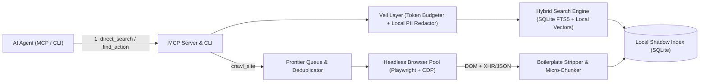

# PRD: VeilCrawl — Direct-Search & Blindfolded Web Engine for AI Agents

> [!NOTE]
> **Working Name:** VeilCrawl  
> **Status:** Draft v1.0  
> **Primary Interface:** MCP Server + CLI (TypeScript / Node.js)

---

## 1. Executive Summary

Modern AI agents struggle with the live web for three compounding reasons:
1. **Slow one-by-one navigation:** Agents click through pages, menus, and pagination sequentially, burning 10–30 LLM turns to find a single fact buried several clicks deep.
2. **Massive token bloat:** Existing scrapers and browser tools dump raw HTML, accessibility trees, or full-page Markdown (10k–50k+ tokens per page) into the agent's context window.
3. **Uncontrolled data exposure:** Sending entire rendered web pages to external LLM providers leaks boilerplate, user data, PII, internal portal details, and proprietary content that the agent never needed to see.

**VeilCrawl** solves all three by combining a **Playwright headless-browser deep crawler**, a **local hybrid search index**, and a **"Barely-See" Veil Layer**. Instead of browsing page-by-page or reading full pages, an agent issues **one direct search query** across an entire JavaScript-rendered website and receives only a **strictly token-budgeted, locally redacted micro-slice** (or opaque action handles) needed to complete its task.

---

## 2. Core Product Pillars

### Pillar 1: Headless Deep-Crawl & Shadow Index
- Renders JavaScript-heavy SPAs, dynamic tabs, accordions, and paginated views using a pooled headless browser (Playwright + Chrome DevTools Protocol).
- Blocks non-essential assets (images, fonts, video, trackers/ads) at the network layer for high-speed crawling.
- Intercepts structured `fetch`/`XHR`/`GraphQL` JSON payloads alongside DOM content.
- Deduplicates infinite URL traps and identical SPA templates via URL normalization + DOM structural fingerprinting (SimHash).
- Stores everything in a **100% local persistent index** so agents can query a site repeatedly with zero re-crawl latency.

### Pillar 2: Direct Search (Zero-Hop Discovery)
- Eliminates page-by-page checking by indexing the entire crawled site into a local **hybrid search engine** (SQLite `FTS5` keyword search + local vector embeddings for semantic search).
- Supports querying:
  - **Content & Facts** (`direct_search`): Instant ranked micro-snippets across all pages, tables, and intercepted APIs.
  - **Interactive Elements** (`find_action`): Locate buttons, forms, links, and download triggers across the whole site in a single call.
  - **Site Structure** (`site_map`): Ultra-compact tree of routes and section headings without page bodies.

### Pillar 3: The "Barely-See" Dual Veil (Minimal Tokens + Privacy)
The agent **never** receives raw HTML, scripts, navbars, footers, or full-page dumps. Every response passes through two mandatory local gates:
1. **Token Compression Gate (Ultra-Low Context)**
   - Strips navigation, boilerplate, and duplicate chrome before indexing.
   - Chunks content into atomic micro-passages (1–3 sentences or single table rows).
   - Enforces a hard `max_tokens` budget per tool call (default: **150–300 tokens**).
   - Uses progressive disclosure: returns opaque chunk/element handles (`c_8f2a`, `el_19`) so the agent only requests more detail if strictly required.
2. **Privacy & Redaction Gate (Blindfolded Visibility)**
   - Runs **100% locally** before any bytes reach the LLM.
   - Redacts sensitive patterns (emails, phone numbers, API keys/tokens, credit cards, SSNs, custom user regexes, and CSS-selector deny-lists) into typed placeholders (`[EMAIL_1]`, `[SECRET_1]`).
   - Supports **Strict Blind Mode**: the agent can search, verify presence/counts, or trigger actions via opaque handles without seeing raw underlying page text.

---

## 3. Target Users & Use Cases

| User Persona | Core Workflow | Value Delivered |
| :--- | :--- | :--- |
| **AI Agent Developers** | Connect Claude, Gemini, Cursor, or custom agents via MCP to research docs or web apps. | 95%+ token reduction; 1-turn answers instead of 15-turn browsing loops. |
| **Privacy-Conscious Teams** | Let cloud LLMs query internal wikis, dashboards, or vendor portals safely. | Raw page content & PII never leave the local machine; only minimal redacted snippets are exposed. |
| **Automation / QA Engineers** | Find specific UI controls, forms, or endpoints across large SPAs without brittle manual selectors. | Instant `find_action` discovery across all reachable app states. |

---

## 4. System Architecture

### Technology Stack
- **Runtime:** Node.js / TypeScript (strict mode)
- **Browser Engine:** Playwright (Chromium) with CDP network interception & resource blocking
- **Local Database & Search:** SQLite (`better-sqlite3`) + `FTS5` (MVP) + `sqlite-vec` with local ONNX embeddings (`@huggingface/transformers`) in Phase 2
- **Agent Protocol:** Model Context Protocol (`@modelcontextprotocol/sdk`) + standalone CLI
- **Parsing & Extraction:** Readability/DOM pruning + custom interactive-element indexer

---

## 5. Functional Requirements & Tool Specification

### 5.1 MCP Tools / CLI Commands

| Tool | Inputs | Output (Veiled) | Purpose |
| :--- | :--- | :--- | :--- |
| `crawl_site` | `url`, `max_pages` (default 50), `max_depth` (default 3), `veil_level` (`standard` \| `strict`), `redact_patterns[]` | Crawl stats (`pages_indexed`, `chunks_count`, `redactions_applied`, `site_id`) — **no raw content** | Deep-crawl & shadow-index a site locally. |
| `direct_search` | `site_id`, `query`, `top_k` (default 5), `max_tokens` (default 250) | Ranked list of `{ chunk_id, url, title, snippet (redacted), score }` | Search the entire crawled site in one shot. |
| `find_action` | `site_id`, `intent` (e.g. `"export CSV"`), `top_k` (default 5) | `{ handle_id, url, role, label (redacted), action_type }` | Locate interactive controls across all pages without clicking around. |
| `site_map` | `site_id`, `max_tokens` (default 200) | Compact indented route tree + page titles + chunk counts | Give the agent a bird's-eye map of the site with near-zero tokens. |
| `peek_chunk` | `site_id`, `chunk_id`, `window` (`0` \| `1`) | Single redacted micro-chunk (plus optional ±1 neighbor) | Controlled progressive disclosure when a snippet needs 1 extra sentence of context. |
| `veil_audit` | `site_id` | Summary of redaction counts by category & total tokens saved vs. raw HTML | Transparency & verification of privacy/token guarantees. |

### 5.2 Veil Modes
1. **`standard` (Default):** Boilerplate stripped, micro-chunked, strict `max_tokens` cap, built-in PII/secret regex redaction enabled.
2. **`strict` (Blindfolded):** Maximum redaction (PII + custom patterns + numbers/identifiers if configured), ultra-tight snippet caps (≤ 120 chars/hit), and metadata-only `site_map`.
3. **`audit` (Local-Only Debugging):** CLI-only flag allowing the *human developer* (never the agent) to inspect what was redacted locally.

---

## 6. Non-Functional Requirements & Guardrails

- **Search Latency:** P95 `< 100ms` for local `direct_search` on a 500-page indexed site.
- **Token Efficiency:** ≥ 95% token reduction compared to passing raw HTML or full-page Markdown to an agent.
- **Zero-Leakage Guarantee:** Raw HTML, cookies, auth headers, and unredacted PII must never be serialized into MCP tool responses.
- **Respectful Crawling:**
  - Strict domain/origin scoping by default (no accidental crawling of the whole internet).
  - Configurable concurrency limits and polite per-host delays.
  - Respects `robots.txt` by default (configurable for authorized/internal staging environments).
  - Explicitly does **not** bypass CAPTCHAs, authentication gates, or access controls.

---

## 7. Phased Roadmap

### Phase 1: MVP (Core Engine + MCP + CLI)
- Playwright deep crawler with CDP asset blocking (images/fonts/media) and BFS frontier queue.
- URL normalization + canonical deduplication.
- Boilerplate stripping + micro-chunker + interactive element extractor.
- SQLite + `FTS5` local shadow index.
- Local Veil Layer: built-in PII/secret redactor + hard `max_tokens` enforcer.
- MCP Server + CLI implementing `crawl_site`, `direct_search`, `find_action`, `site_map`, `peek_chunk`, and `veil_audit`.

### Phase 2: Semantic Search & SPA Mastery
- Hybrid search: add local ONNX embeddings (`sqlite-vec`) fused with `FTS5` via Reciprocal Rank Fusion (RRF).
- CDP `fetch`/`XHR`/`GraphQL` JSON response indexing.
- SimHash DOM fingerprinting to eliminate SPA template/pagination loops.
- Smart tab/accordion expansion during crawl to capture hidden client-side content.

### Phase 3: Blind Execution & Live Governance
- **Blind Actions:** Allow the agent to execute actions via opaque handles (`run_action(handle_id, redacted_params)`) without ever seeing the page DOM.
- Incremental re-crawling (ETag / content-hash diffing) so indexes stay fresh automatically.
- Local web dashboard showing the site graph, token savings meter, and a real-time "Agent View vs. Real Page" redaction diff.

---

## 8. Success Metrics

| Metric | Target |
| :--- | :--- |
| **Token Reduction** | ≥ 95% fewer tokens sent to LLM vs. raw Markdown/DOM scraping |
| **Agent Turns to Answer** | 1–2 tool calls (down from 10+ page-by-page navigation turns) |
| **Direct Search Latency** | < 100ms P95 on local index |
| **PII / Secret Leakage** | 0 unredacted matches for configured redaction classes in automated tests |

---

## 9. Open Decisions for Sign-Off

1. **Project Directory:** Should we scaffold this inside `/Users/user/scrappy` or create a fresh directory (e.g., `/Users/user/veilcrawl`)?
2. **Phase 1 Scope:** Does starting with **Phase 1 (Playwright deep crawler + SQLite FTS5 + Local Veil Redactor + MCP Server & CLI)** look right, or do you want local vector embeddings included in v1?
3. **Target Stack:** Confirm **TypeScript / Node.js** (best native Playwright & MCP ecosystem) vs. **Python**.
