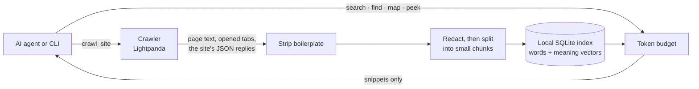

<div align="center">

# VeilCrawl

**Let AI agents search a whole website without reading it.**

Crawl once, index locally, and answer with small, redacted snippets.

[](LICENSE)


-orange)

[Quick start](#quick-start) · [Use cases](#use-cases) · [Tools](#tools) · [How it works](#how-it-works) · [Privacy](#privacy) · [Configuration](#configuration)

</div>

---

## Why VeilCrawl

Agents usually read websites one full page at a time. That is slow, fills the context window, and sends everything on the page to a model provider.

| | Browsing page by page | VeilCrawl |
| :--- | :--- | :--- |
| **Finding a fact** | Open pages until it turns up | One search across every indexed page, by words and by meaning |
| **What the model sees** | Whole pages | Ranked snippets, 250 tokens by default |
| **Emails, keys, card numbers** | Sent as they are | Replaced on your machine with `[EMAIL_1]`, `[SECRET_1]` |
| **Asking again** | Load the pages again | Local index, no new requests |

## Quick start

Requires Node.js 22.18 or newer.

### 1. Install Lightpanda

VeilCrawl uses [Lightpanda](https://lightpanda.io), a lightweight headless browser built for automation. You do not need Chromium.

**macOS (Homebrew)**

```sh
brew install lightpanda-io/browser/lightpanda
```

**Linux (x86_64) and WSL2**

```sh
mkdir -p ~/.local/bin
curl -fL -o ~/.local/bin/lightpanda https://github.com/lightpanda-io/browser/releases/download/nightly/lightpanda-x86_64-linux
chmod a+x ~/.local/bin/lightpanda
~/.local/bin/lightpanda version
```

Other platforms: see the [Lightpanda nightly builds](https://github.com/lightpanda-io/browser/releases/tag/nightly).

<details>
<summary><b>Prefer Chromium?</b></summary>

Skip the step above and run this after `npm install`. VeilCrawl uses Chromium when Lightpanda is not installed.

```sh
npx playwright install chromium --only-shell
```

</details>

### 2. Install VeilCrawl

```sh
npm install -g veilcrawl
```

This includes local semantic search, which adds about 230 MB of runtime. To skip it and search by words only, add `--omit=optional`.

<details>
<summary><b>From source</b></summary>

```sh
git clone https://github.com/Baimmmss/veilcrawl.git
cd veilcrawl
npm install
npm link
```

</details>

### 3. Connect an agent

**Claude Code**

```sh
claude mcp add --scope user veilcrawl -- veilcrawl mcp
```

<details>
<summary><b>Cursor, Claude Desktop and other MCP clients</b></summary>

```json
{
  "mcpServers": {
    "veilcrawl": {
      "command": "veilcrawl",
      "args": ["mcp"]
    }
  }
}
```

If the client cannot find `veilcrawl`, use the full path from `which veilcrawl`.

</details>

Then ask in plain language:

> Use veilcrawl to crawl https://docs.python.org/3/library/sqlite3.html, at most 12 pages, then find how transactions are opened.

### Or use the command line

```sh
veilcrawl crawl_site https://docs.python.org/3/library/sqlite3.html --max_pages 12 --max_depth 1
veilcrawl direct_search s_0bd11525fdbe open database connection --top_k 1
```

```json
{
  "full_matches": 25,
  "hits": [
    {
      "chunk_id": "c_ce",
      "url": "https://docs.python.org/3/library/sqlite3.html",
      "title": "sqlite3 — DB-API 2.0 interface for SQLite databases — Pyth…",
      "snippet": "sqlite3 ensures that a transaction is always open, so connect(), Connection.commit(), and …",
      "score": 0.0325
    }
  ]
}
```

<sub>Snippet shortened for this page.</sub>

> [!TIP]
> Large crawls can outlast an MCP client's timeout. Run them from the command line and give the agent the `site_id`.

## Use cases

Real runs, captured on 25 and 27 November 2026. Sites change, so your results may differ. Only the key fields are shown.

### Answer a question from long documentation

> Which Python setting controls sqlite3 transactions?

```sh
veilcrawl crawl_site https://docs.python.org/3/library/sqlite3.html --max_pages 8 --max_depth 1
veilcrawl direct_search s_0bd11525fdbe default isolation level transaction --top_k 1
```

```text
If Connection.autocommit is set to LEGACY_TRANSACTION_CONTROL (the default), transaction
behaviour is controlled using the Connection.isolation_level attribute. Otherwise,
isolation_level has no effect.
```

The agent read about 140 tokens: 45 from the crawl and 96 from the search. See [Measured results](#measured-results) for what it would read otherwise.

### Read a contact page without seeing the contact details

> Can I get professional support for SQLite?

```sh
veilcrawl crawl_site https://sqlite.org/support.html --max_pages 8 --max_depth 1
veilcrawl direct_search s_02d149a916eb email contact professional support --top_k 3
```

```text
If you would like professional support for SQLite or if you want custom modifications …
… Applied Software Research [PHONE_1] [EMAIL_1] | More Info
```

The agent learns that support exists and where to look. The phone number and email stay on your computer. Names are not hidden.

### Find an answer that uses other words

> How do I turn a row into a dictionary?

```sh
veilcrawl direct_search s_0bd11525fdbe convert row to dictionary --top_k 2
```

```text
You can create a custom row_factory that returns each row as a dict, with column names mapped to values:
```

No passage contains "convert row to dictionary", so a word search returns passages about type converters. Semantic search finds the answer as the second hit.

### Find a button without clicking through the site

> Where do I download the Node.js installer?

```sh
veilcrawl crawl_site https://nodejs.org/en/download --max_pages 8 --max_depth 1
veilcrawl find_action s_34c1e9411b53 download installer --top_k 1
```

```text
Windows Installer (.msi)   button   https://nodejs.org/en/download
```

### Search a site in another language

> 在维基百科的 SQLite 页面里查找“事务”。

```sh
veilcrawl crawl_site https://zh.wikipedia.org/wiki/SQLite --max_pages 3 --max_depth 1
veilcrawl direct_search s_87a1bc3e9425 事务 --top_k 1
```

```text
程式庫实现了多数的SQL-92标准,包括事务,以及实现原子性、一致性、隔離性和持久性(即ACID),但它缺失了某些特性。…
```

### Where it does not fit

- **Pages behind a login:** VeilCrawl does not sign in.
- **Clicking or filling in forms:** it finds controls but cannot use them yet. It opens tabs and accordions while crawling, and nothing else.
- **Meaning in other languages:** semantic search uses an English model. Other languages are searched by words only.

## Tools

The MCP server and the command line share the same six tools.

| Tool | What it does | Main options |
| :--- | :--- | :--- |
| `crawl_site` | Crawls and indexes a site. Returns statistics, never content. | `max_pages` 50 · `max_depth` 3 · `veil_level` · `redact_patterns` · `redact_selectors` |
| `direct_search` | Searches every indexed page, by words and by meaning. | `top_k` 5 · `max_tokens` 250 |
| `find_action` | Finds buttons, links, forms and downloads. | `top_k` 5 |
| `site_map` | Shows a compact tree of routes. | `max_tokens` 200 |
| `peek_chunk` | Reads one search hit, with its neighbours if asked. | `window` 0 or 1 |
| `veil_audit` | Reports redaction counts and tokens saved per search. | |

## How it works



Text is redacted **before** it is indexed, so a hidden value cannot be found by searching for it.

- **Search** ranks passages by matching words (SQLite FTS5) and by meaning (a small local model, [all-MiniLM-L6-v2](https://huggingface.co/Xenova/all-MiniLM-L6-v2)), then merges both lists with reciprocal rank fusion. The model runs on your machine. It reads only redacted text and the agent's query.
- **Single-page apps:** before reading a page, the crawler opens `<details>`, accordions and every tab, so text that appears only after a click is indexed. It does not click links, menus or form controls.
- **API replies:** JSON that the site's own pages fetch from the same host is indexed too, one row per object. Fields named like secrets (`token`, `password`, `api_key` and similar) are dropped, and the rest is redacted like page text.
- **Duplicates:** a page with no text or control that an earlier page lacked, such as a list sorted another way, is skipped, and its links are not followed. This stops sort, filter and paging loops.

The crawler stays on the starting host, obeys `robots.txt`, waits between page loads, identifies itself as VeilCrawl, and does not bypass logins or CAPTCHAs.

## Privacy

| Mode | Behaviour |
| :--- | :--- |
| `standard` | Redacts emails, phone numbers, US Social Security numbers, card numbers, and API keys and tokens |
| `strict` | Also redacts IP addresses, UUIDs and long numbers, caps snippets at 120 characters, leaves titles out of the site map, and does not index API replies |

Add your own rules when you crawl:

```sh
veilcrawl crawl_site https://example.com --veil_level strict \
  --redact_patterns 'acme-\d+' --redact_selectors '.internal'
```

These settings stay on for the whole site: later crawls can add to them, but not remove them. To start over, delete the site's file in `~/.veilcrawl/veils`.

To see what was hidden, add `--audit` to `crawl_site`. It prints the hidden values and works only in an interactive terminal.

> [!WARNING]
> **Know the limits before using this on sensitive sites.**
> - Redaction is pattern-based. It misses names, street addresses and disguised values, and sometimes hides harmless numbers.
> - The agent chooses `veil_level` the first time it crawls a site, unless you set `VEILCRAWL_VEIL=strict`.
> - Settings belong to one host and port. The same pages under another name, such as a subdomain or an IP address, are a separate site.
> - API replies often hold more than the page shows. They are indexed only on `standard` sites without `redact_selectors`, because a selector cannot hide a value inside JSON. Use `strict`, or any `redact_selectors`, to keep them out.
> - Hidden values are not saved, but an agent with shell access can read the redacted index and your `redact_patterns`, delete the saved settings, or open the site without VeilCrawl.

The first crawl downloads the 23 MB search model from Hugging Face into `~/.veilcrawl/models`. It sends no page content and no queries. After that, VeilCrawl works offline. If the download fails, search falls back to matching words.

Indexes are stored in `~/.veilcrawl`. A site that nobody crawls or reads for 7 days is deleted the next time VeilCrawl is used. Delete `<site_id>.db` to forget a site sooner. The settings in `veils` are kept until you delete them. Indexes made by an older version are deleted when used, so crawl those sites again.

## Configuration

| Variable | Effect | Default |
| :--- | :--- | :--- |
| `VEILCRAWL_HOME` | Where indexes are stored | `~/.veilcrawl` |
| `VEILCRAWL_VEIL` | `strict` forces strict mode on every crawl, whatever the agent asks for | `standard` |
| `VEILCRAWL_ENGINE` | `auto`, `lightpanda` or `chromium` | `auto` |
| `VEILCRAWL_SEMANTIC` | `off` turns semantic search off and never downloads the model | On |
| `LIGHTPANDA_PATH` | Path to the Lightpanda binary | Found automatically |

`auto` uses Lightpanda when it is installed and Chromium otherwise. Lightpanda is looked for in `LIGHTPANDA_PATH`, `PATH`, `~/.local/bin`, `/usr/local/bin` and `/opt/homebrew/bin`.

These `crawl_site` options work only from the command line, so an agent cannot change them over MCP:

| Option | Effect | Default |
| :--- | :--- | :--- |
| `--engine` | Overrides `VEILCRAWL_ENGINE` | |
| `--concurrency` | Pages loaded at once | 4 |
| `--delay_ms` | Minimum gap between page loads | 200 |
| `--timeout_ms` | Page load timeout | 15000 |
| `--ignore_robots` | Skips `robots.txt`, for sites you are authorized to crawl | Off |

## Measured results

| Target | Goal | Measured |
| :--- | :--- | :--- |
| Search latency, P95, 500 pages, words only | under 100 ms | 27–67 ms |
| Search latency, P95, 500 pages, words and meaning | under 100 ms | 92 ms, about 50 ms typical |
| Planted secrets reaching the agent | 0 | 0 of 23 |

<sub>Measured on one Intel macOS machine; words and meaning under a load average of about 19. Latency rises under heavy CPU load. The first search after starting also loads the model, which takes about a second. The secrets test runs as part of <code>npm test</code>.</sub>

### Tokens

What an agent would read for the three English use cases above:

| | Python docs | SQLite support | Node.js download |
| :--- | ---: | ---: | ---: |
| All 8 pages, raw HTML | 429,558 | 55,086 | 1,211,909 |
| All 8 pages, clean text | 59,189 | 7,036 | 9,482 |
| Only the right page, clean text | 15,868 | 394 | 568 |
| **VeilCrawl, crawl and search** | **about 140** | **about 215** | **about 85** |

- **Large savings on long pages,** or when the agent does not know which page has the answer.
- **Little or no saving on one short page.** The tool descriptions add about 750 tokens to a conversation, so if the agent already knows the right SQLite or Node.js page, reading it directly is cheaper.

<sub>Counted with gpt-tokenizer on 25 November 2026; other models count differently. Clean text is the browser's visible text. Each search is capped at 250 tokens by default.</sub>

## Development

```sh
npm test           # unit, latency and real-browser tests
npm run typecheck
npm run build
```

`npm test` turns semantic search off, except in one test that downloads the model once into `node_modules/.cache`.

To release, bump `version` in `package.json` and `src/mcp.ts`, then run `npm test` and `npm publish`. Publishing builds `dist` first.

`npm audit` in a project that installs VeilCrawl reports `sharp`, an image library that the search model's package requires. VeilCrawl never decodes images. Transformers 4, which fixes this, no longer runs on Intel Macs. Install with `--omit=optional` to leave it out.

## Roadmap

- [x] **Phase 1:** crawler, local search, redaction, MCP server and CLI
- [x] **Phase 2:** semantic search, API response indexing, tab and accordion expansion, duplicate-loop skipping
- [ ] **Phase 3:** running actions through handles, incremental crawls, local dashboard

See [PRD.md](PRD.md) for the full plan.

## License

[MIT](LICENSE)
